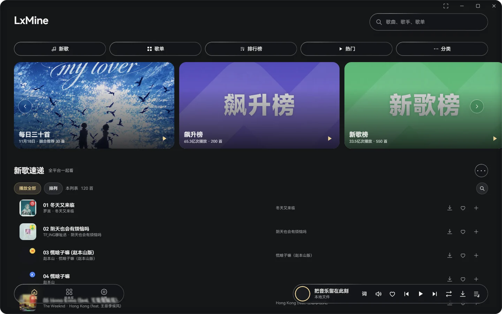
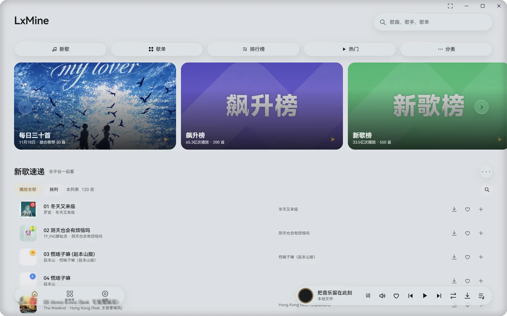
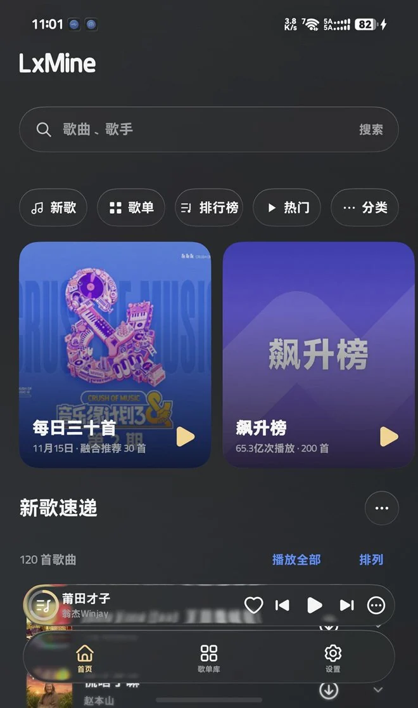
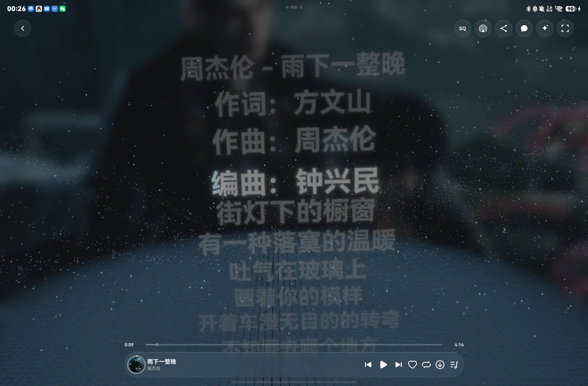
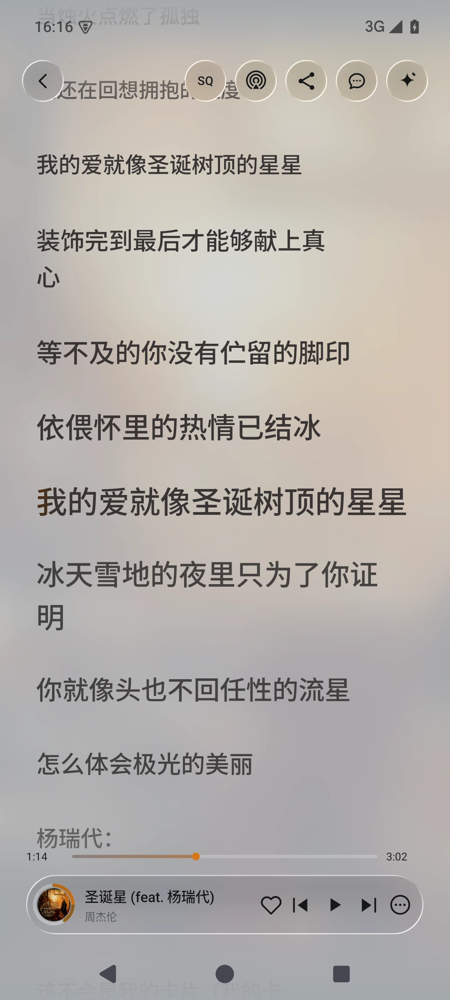

<p align="center">
  
</p>

# LxMine

跨端音乐播放器，面向 **Windows**、**Android** 与 **HarmonyOS 手机 / 平板 / 车机**。

**官网：[yurilin1028.github.io/LxMine](https://yurilin1028.github.io/LxMine/)** · 极简产品预览、多端介绍与国内镜像加速下载。

LxMine 以 [Mineradio](#上游与致谢) 2.2.0 的沉浸视觉与桌面体验为基座，接入
[LX Music](#上游与致谢) 的自定义音源协议与音乐资料库能力，统一 PC 与鸿蒙端的首页、
歌单、搜索、本地音乐与播放详情体验，并提供 Android 原生客户端。

当前版本 **1.2.0**（2026-11-19），安装包见 [Releases](https://github.com/YuriLin1028/LxMine/releases/latest)。
版本内容见 [RELEASE_NOTES](docs/RELEASE_NOTES.md)，构建与发布记录见 [RELEASE](docs/RELEASE.md)。

## 界面预览

<p align="center">
  
  
</p>
<p align="center">
  
  
  
</p>

## 上游与致谢

本项目是站在两个开源项目肩膀上的衍生作品，特此明确来源：

| 上游 | 作者 | 许可证 | 在本项目中的作用 |
| --- | --- | --- | --- |
| [LX Music（洛雪音乐助手）](https://github.com/lyswhut/lx-music-desktop) | lyswhut 及贡献者 | Apache-2.0（附附加条款） | 自定义音源协议、公开搜索、歌曲元数据、歌词与歌单互换 |
| [Mineradio](https://github.com/XxHuberrr/Mineradio-paused) | XxHuberrr | GPL-3.0-only | 桌面端基座：沉浸视觉、歌词舞台、3D 歌单架、电影镜头系统 |

- LX Music 仓库：<https://github.com/lyswhut/lx-music-desktop>
- Mineradio 仓库：<https://github.com/XxHuberrr/Mineradio-paused>（原 `XxHuberrr/Mineradio` 重定向至此）
- 固定版本、提交号与修改边界见 [docs/UPSTREAM.md](docs/UPSTREAM.md)；完整声明见 [NOTICE.md](NOTICE.md)。

LxMine 不是 LX Music 或 Mineradio 的官方版本，与两位作者无隶属或背书关系。
上游名称、Logo 与原创视觉设计的权利归各自作者所有。

## 功能

- **四平台融合首页**：每日三十首、跨平台榜单概念合并、分类板块、快捷胶囊。
- **统一歌曲列表**：每个列表都有播放全部、排列（拖动式手动排序）与列表内搜索。
- **歌单库**：时刻相册式随机拼贴封面。
- **本地音乐**：目录扫描、元数据与内嵌封面读取、歌词解析、下载收纳。
- **PC 沉浸光感**：指针追光、系统材质、锚点弹窗、无边框窗口 chrome 与按压反馈。
- **鸿蒙原生端**：ArkTS / ArkUI 导航与播控，应用接续、局域网同步、横屏沉浸。
- **Android 原生端**提供 Compose 界面，Android 13 及以上使用液态玻璃交互。
- **外观与动效**支持深色、浅色、跟随系统，以及播放页「关闭动效」。
- **多音源兼容**支持 LX 自定义源脚本批量导入、重复跳过和逐文件错误提示。

## 安装

### Windows

从 [Releases](https://github.com/YuriLin1028/LxMine/releases/latest) 下载
`LxMine-1.2.0-Setup.exe` 安装，或下载 `LxMine-1.2.0-Portable.exe` 运行。
安装包没有商业代码签名，SmartScreen 可能提示
“未知发布者”，选择“更多信息 → 仍要运行”即可。

### Android

从 Releases 下载 `LxMine-1.2.0-Android.apk` 安装，最低支持 Android 8.0。
Android 13 及以上提供液态玻璃与水球导航交互，Android 12 及以下适配普通点击反馈。
首次使用可在「设置 → 音源」多选导入自行获得的 JS/TXT 脚本。

### HarmonyOS（未签名 HAP）

从 Releases 下载 `LxMine-1.2.0-HiCar-unsigned.hap`，`bundleName` 为
`cn.migu.music`，支持 phone / tablet / car，versionName 1.2.0。

未签名 HAP **不能直接安装**，需要先完成签名：

1. 在手机“设置 → 关于本机”连续点击版本号开启开发者模式，并在“系统和更新 →
   开发人员选项”打开 USB 调试。
2. 使用自动签名工具为 HAP 签名并安装。可参考 [sydxky.cn](https://sydxky.cn/)
   的“安装工具”页面，使用 HoKit、小白调试助手等工具；这类工具会自动申请绑定
   当前设备的调试证书。该站点是第三方社区站点，本仓库不隶属于它，使用前请自行
   确认工具来源与隐私政策。
3. 也可以在 DevEco Studio 中打开 `apps/harmony`，登录华为账号并勾选自动签名，
   然后执行 `hdc install -r <signed>.hap`。

调试证书与设备 UDID 绑定，换机或证书过期后需要重新签名。`cn.migu.music` 仅用于
兼容已安装设备与应用接续，本项目与咪咕音乐无关。

### HarmonyOS（应用市场邀请测试）

[**加入 LxMine 1.2.0 邀请测试**](https://appgallery.huawei.com/link/invite-test-wap?taskId=7181c9f3cfda4854dc2f0d8fec00ab40&invitationCode=1Klp9jEJXOp)

使用鸿蒙系统自带浏览器打开完整链接，点击「开始测试」，首次参与时点击「同意」加入
测试群组，然后点击「安装」。1.2.0 沿用同一测试群组，已有用户可从应用市场「应用尝鲜」
查看可用版本并更新。转发时请保留完整的
`&invitationCode=1Klp9jEJXOp` 参数。

在微信、QQ、抖音等应用中收到链接时，请复制下面的完整网址到手机系统自带浏览器的地址栏，
再点击网页里的「开始测试」。

```text
https://appgallery.huawei.com/link/invite-test-wap?taskId=7181c9f3cfda4854dc2f0d8fec00ab40&invitationCode=1Klp9jEJXOp
```

当前测试包最低兼容 API 26.0.0，支持手机、平板和 PC/2in1，包名为 `com.lxmine.player`。
邀请测试版无内置音源，音源由用户自行导入，HiCar 入口已隐藏。车机兼容包
（`cn.migu.music`）通过上方的未签名 HAP 安装方式分发。

邀请名额上限为 **10000 人**，邀请码有效至 **2026-12-16 12:46（北京时间）**。
本轮测试至 **2027-02-14 13:15（北京时间）**。

出包与 AGC 操作见 [docs/INVITE_TEST.md](docs/INVITE_TEST.md)，命令为
`npm run build:store`。

## 目录结构

```
apps/desktop/                Electron 桌面端（Mineradio 基座 + LX 音源层）
apps/android/                Android Kotlin / Compose 原生客户端
apps/harmony/                HarmonyOS ArkTS 工程（手机 / 平板 / 车机）
apps/watch-wearable/         华为 WATCH 手表端（ArkTS / ArkUI）
apps/watch-lite/             华为 GT / FIT 手表端（Lite Wearable）
packages/huawei-immersive-pc 华为式沉浸光感 PC 标准包（独立 MIT 许可）
docs/                        构建、来源、同步、版本与验收文档
scripts/                     打包、同步与清理脚本
qa/                          材质门禁与 UI 验收脚本、参考基线
```

## 构建与运行

需要 Node.js 20+ 与 PowerShell 7。

```powershell
npm --prefix apps/desktop ci
npm start                 # 启动桌面端
npm run build:win:dir     # 生成免安装目录
npm run build:win         # 生成 NSIS 安装包
```

鸿蒙工程用 DevEco Studio 打开 `apps/harmony`，签名与构建步骤见
[docs/HARMONY.md](docs/HARMONY.md)。命令行打包可执行 `npm run build:harmony`。

手表端可执行 `npm run build:watch` 构建首版演示包。真机调试、原生沉浸光感和联调状态见
[手表端开发说明](docs/WATCH.md)。

沉浸光感标准包可独立验证：

```powershell
cd packages/huawei-immersive-pc
npm run validate
npm run smoke
```

## 音源脚本不随仓库分发

`音源/`、桌面端内置音源种子与鸿蒙 rawfile 中的音源脚本均为第三方社区作品，
作者与授权条款各不相同，部分脚本内含 API key。它们已被 `.gitignore` 排除，
不属于本仓库及其许可证范围。

首次运行后请在应用内「设置 → 音源」导入你自行获得的 LX 自定义源脚本。请遵守
各音乐平台的服务条款与版权规则。

## 许可证

- 本仓库整体以 **GPL-3.0-only** 发布，全文见 [LICENSE](LICENSE)。桌面端衍生自
  GPL-3.0 的 Mineradio，因此整体必须沿用 GPL-3.0。
- `packages/huawei-immersive-pc` 单独以 **MIT** 发布，见该目录下的 `LICENSE`。
- 第三方库、移植模块与服务声明见 [NOTICE.md](NOTICE.md)、
  [apps/desktop/NOTICE.md](apps/desktop/NOTICE.md) 与
  [THIRD_PARTY_PORTS.md](apps/desktop/docs/THIRD_PARTY_PORTS.md)。

## 说明与免责声明

- 本项目不提供、不托管任何音乐内容，也不提供绕过付费或版权保护的能力。
- 本项目与网易云音乐、QQ 音乐、酷我、酷狗、咪咕音乐、Spotify 等平台均无隶属关系，
  不是任何平台的官方客户端。
- 鸿蒙 `hicar` 产品为兼容已安装设备与应用接续，沿用历史包名 `cn.migu.music`；
  该包仅用于本地调试安装，与咪咕音乐无关，公开分发前请改为自有包名。
- 软件按现状提供，不附带任何担保；使用造成的后果由使用者自行承担。
